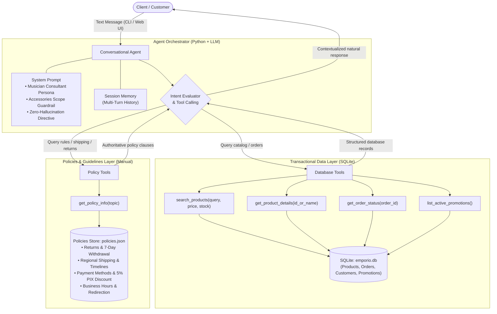

# Empório da Música — Customer Support Agent

Technical assessment solution developed for the **Artefact** AI Engineer hiring process. This project implements a conversational text-based agent built in Python designed to support the customer service operations of **Empório da Música**, a musical instruments retail store located in Campo Grande/MS (Brazil).

The agent is designed to relieve the human support team by handling recurring inquiries regarding product catalog browsing, pricing, stock availability, order tracking and delivery status, business hours, and operational store policies (returns, warranties, regional shipping, and payment conditions).

---

## 1. Solution Overview and Architecture

The system follows a **Hybrid Agent architecture driven by Tool Calling (Function Calling)**. Rather than relying on unconstrained Text-to-SQL or naive unstructured RAG (both of which introduce risks of hallucinated transactional data or arbitrary command execution), the agent operates as a structured intent router equipped with typed, validated, and deterministic Python tools.

### Architecture Flowchart



---

## 2. Technical Decisions & Rationale

### 2.1 Framework & Agent Approach (Tool Calling vs. Raw SQL vs. Naive RAG)
- **Why Tool Calling:** Modern foundation models (such as Gemini 2.5 Flash and GPT-4o-mini) provide calibrated, schema-constrained structured outputs (JSON).
- **Why Not Freeform Text-to-SQL:** Allowing an LLM to generate and execute arbitrary SQL queries against production tables in real time introduces serious vulnerabilities: exposure of sensitive customer PII, performance degradation, and malformed query syntax. Encapsulating access inside dedicated Python tools provides strict parameter validation, type safety, and parameterized queries.
- **Domain Separation:** Transactional operations (products, orders, customer records, promotions) reside inside indexed relational tables (SQLite), whereas business policies and guidelines from the internal manual are served via a dedicated policy retriever, ensuring adherence to terms without numerical hallucination.

### 2.2 Data Layer (SQLite & Ingestion Pipeline)
- Operational CSV datasets (`categories`, `customers`, `products`, `orders`, `order_items`, `promotions`) are ingested into a local relational SQLite database (`data/emporio.db`).
- The database schema establishes foreign key constraints and creates indexes over high-frequency lookup fields (`category_id`, `name`, `price_brl`, `customer_id`, `product_id`).
- A standalone loader module (`emporio_agent.db.loader`) provides deterministic database initialization and re-seeding at any point.

### 2.3 LLM Provider & Model Flexibility
- The agent client (`LLMClient`) is decoupled from proprietary interfaces, offering plug-and-play support configured via environment variables:
  - **Google Gemini** (`gemini-2.5-flash` or `gemini-1.5-flash`) via the official `google-genai` SDK.
  - **OpenAI / Groq** (`gpt-4o-mini`, `llama-3.3-70b-versatile`) via the `openai` client.
  - **Ollama** for 100% offline, local open-source model execution.
  - **Deterministic Offline Mock:** For integration tests, continuous integration (CI), and sandboxed evaluation without API keys or internet access, an internal mock emulator deterministically resolves tool calls and formats responses matching expected evaluation scenarios.

### 2.4 Prompt Strategy & Persona Guardrails
- **Tone & Persona:** Welcoming, knowledgeable, and informal yet professional ("a friendly, trusted musician who knows instruments inside out"), optimized for conversational WhatsApp channels.
- **Strict Scope Guardrail (No Accessories):** The store operates exclusively with complete musical instruments and **does not sell accessories** (guitar strings, picks, cables, pedals, cases/gigbags, or amplifiers). The prompt instructs the model to recognize accessory inquiries, politely refuse them, and refer customers to local partner shops.
- **Grounding (Zero Hallucination):** The model is explicitly forbidden from asserting product prices, inventory levels, or delivery dates without first obtaining authoritative records from the corresponding tool.
- **Out-of-Stock Handling:** When an item has zero available inventory, the agent communicates the unavailability transparently and queries the database for comparable alternatives in the same category or price range.

### 2.5 Handling Policy Manual Contradictions & Business Assumptions
As guided by the assessment specifications (*"assume a reasonable interpretation, document the assumption, and proceed"*), the following four operational contradictions found in the store's internal manual were systematically analyzed and resolved:

1. **WhatsApp Contact Number Discrepancy:**
   - *Conflict:* Company Data (Table 1.2, Page 2) lists `(67) 3341-4444`, whereas Section 7 (WhatsApp Customer Service, Page 6) designates `(67) 3321-4500` as the primary messaging channel.
   - *Resolution:* `(67) 3341-4444` is treated as the store's physical landline/reception, while `(67) 3321-4500` is the dedicated customer service WhatsApp line.
2. **Credit Card Minimum Installment Rules:**
   - *Conflict:* Section 3 overview table states a flat `R$ 100.00` minimum installment, but Section 3.1 specifies tiered thresholds (up to 3x: no min except <R$ 50; 4x-6x: R$ 80 min; 7x-12x: R$ 100 min).
   - *Resolution:* The granular tiering in Section 3.1 takes precedence as the authoritative operational rule.
3. **Defect Exchanges (30 Days) vs. Statutory Warranty (90 Days CDC):**
   - *Conflict:* Section 4.2 states direct store exchanges occur within 30 days, whereas Section 8.1 cites the 90-day statutory warranty under the Brazilian Consumer Protection Code (CDC).
   - *Resolution:* The store provides immediate direct replacement within the first 30 days; from day 31 to 90, the store intermediates the warranty process with the manufacturer.
4. **Non-Cumulativeness of PIX Discount with Promotions:**
   - *Conflict:* Section 3 mentions an upfront 5% PIX discount, but Section 6.2 states that PIX discounts do not apply to products already on promotional pricing.
   - *Resolution:* Section 6.2 takes precedence (promotional items are strictly excluded from the additional 5% PIX discount).

---

## 3. Repository Structure

```text
emporio-da-musica-agent/
├── data/                               # Operational datasets and policy documents
│   ├── categories.csv
│   ├── customers.csv
│   ├── order_items.csv
│   ├── orders.csv
│   ├── products.csv
│   ├── promotions.csv
│   ├── politicas_da_loja.pdf
│   └── policies.json                   # Structured policy knowledge base
├── src/
│   └── emporio_agent/
│       ├── db/                         # Database manager and CSV loader
│       │   ├── database.py
│       │   └── loader.py
│       ├── tools/                      # Catalog, order, and policy tools
│       │   ├── catalog.py
│       │   ├── orders.py
│       │   ├── policies.py
│       │   └── promotions.py
│       ├── agent/                      # Prompts, LLM client, and orchestrator
│       │   ├── llm_client.py
│       │   ├── orchestrator.py
│       │   └── prompts.py
│       └── interfaces/                 # User interfaces
│           ├── cli.py                  # Interactive terminal CLI
│           └── web.py                  # Interactive Web UI (Streamlit)
├── tests/                              # Automated test suite (unittest / pytest)
│   ├── test_tools.py
│   └── test_agent.py
├── examples/                           # Required sample interaction transcripts
│   ├── 01_catalogo_violoes_ate_1000.md
│   ├── 02_informacoes_loja_horarios.md
│   ├── 03_consulta_preco_takamine_gd20.md
│   ├── 04_politica_devolucao_arrependimento.md
│   └── 05_situacao_nao_trivial_rastreio_e_escopo.md
├── Dockerfile                          # Unified container image definition
├── docker-compose.yml                  # Multi-service container orchestration
├── requirements.txt                    # Project runtime dependencies
├── pyproject.toml                      # Standard packaging metadata
└── README.md
```

---

## 4. How to Run the Project

You can run the project either **using Docker Compose** (recommended, as it encapsulates all dependencies) or **directly in a local Python environment**.

### 4.1 Method 1: Using Docker Compose (Recommended)

The provided `docker-compose.yml` configures ready-to-run services for the Web UI, CLI, automated tests, and database seeding.

1. **Configure Environment Variables (Optional):**
   ```bash
   cp .env.example .env
   # Edit .env if you wish to provide an API key (GEMINI_API_KEY or OPENAI_API_KEY).
   # If no key is provided, the agent runs in deterministic 'mock' mode automatically.
   ```

2. **Launch the Interactive Web UI (Streamlit):**
   ```bash
   docker compose up agent-web
   ```
   Open your browser at: `http://localhost:8501`.

3. **Run the Interactive Terminal CLI:**
   ```bash
   docker compose run --rm agent-cli
   ```

4. **Execute the Automated Test Suite:**
   ```bash
   docker compose run --rm test
   ```

5. **Re-seed the SQLite Database:**
   ```bash
   docker compose run --rm seed-db
   ```

---

### 4.2 Method 2: Local Python Execution

Requirements: Python 3.10 or higher.

1. **Create and Activate a Virtual Environment:**
   ```bash
   python3 -m venv .venv
   source .venv/bin/activate
   ```

2. **Install Dependencies:**
   ```bash
   pip install -r requirements.txt
   ```

3. **Seed the SQLite Database:**
   ```bash
   python3 -m emporio_agent.db.loader
   ```

4. **Run the Test Suite:**
   ```bash
   python3 -m unittest discover -s tests
   # or with pytest:
   pytest tests/ -v
   ```

5. **Start the Interactive CLI:**
   ```bash
   python3 -m emporio_agent.interfaces.cli
   ```

6. **Start the Web UI:**
   ```bash
   streamlit run src/emporio_agent/interfaces/web.py
   ```

---

## 5. Interaction Examples

As specified in the assessment requirements, the `examples/` directory contains 5 complete conversation transcripts illustrating different flows and background tool executions:

1. **[`01_catalogo_violoes_ate_1000.md`](examples/01_catalogo_violoes_ate_1000.md):** Catalog search with category filter ("Violões" / Acoustic Guitars), maximum price limit (R$ 1,000.00), and positive stock availability check.
2. **[`02_informacoes_loja_horarios.md`](examples/02_informacoes_loja_horarios.md):** General store inquiries regarding physical location in Campo Grande, official contact channels, and weekend operating hours.
3. **[`03_consulta_preco_takamine_gd20.md`](examples/03_consulta_preco_takamine_gd20.md):** Targeted product inquiry for the Takamine GD20, retrieving technical tonewood specifications, pricing, up to 12x interest-free installment options, and 5% upfront PIX discount.
4. **[`04_politica_devolucao_arrependimento.md`](examples/04_politica_devolucao_arrependimento.md):** Application of consumer protection policies (7-day statutory right of withdrawal for online orders, store-covered return shipping, and 10-day refund window).
5. **[`05_situacao_nao_trivial_rastreio_e_escopo.md`](examples/05_situacao_nao_trivial_rastreio_e_escopo.md):** Non-trivial combined scenario: real-time order tracking with carrier tracking code, followed by customer inquiry regarding guitar strings and picks, triggering the strict accessories refusal guardrail.

### 5.1 Model Evaluation & Verification
- **Production Evaluation Model:** All 5 sample interactions were generated and validated using **Google Gemini 2.5 Flash** (`gemini-2.5-flash` at temperature 0.2) via live schema-constrained Function Calling against the local SQLite database and policy engine.
- **Reproducibility:** The repository also embeds an automated test suite (`tests/`) and an internal deterministic mock emulator ensuring that every conversation flow can be verified 100% offline without external API latency or billing.

---

## 6. Known Limitations & Next Steps (With More Time)

- **Vector Semantic Embeddings for Policies:** The policy retriever currently maps user queries to curated policy topics. At greater document scale, integrating a vector database (such as ChromaDB or Qdrant) with dense sentence embeddings would allow granular retrieval of complex policy clauses.
- **Secure Customer Order Authentication (2FA/OTP):** Current lookups retrieve order status by order ID. In production, a verification challenge (one-time code sent via SMS/WhatsApp to the registered customer phone) should precede the disclosure of sensitive delivery data.
- **Direct WhatsApp Business API Integration:** Connecting the orchestrator to Meta's Cloud API or a messaging gateway would allow direct end-to-end messaging with real store customers.
- **Catalog Query Caching (Redis):** Implementing in-memory caching for frequent product and inventory searches to minimize database roundtrips and latency.
- **Human Handoff Workflow:** An automated escalation trigger that routes conversations to human agents upon explicit request or sentiment degradation.

---

## 7. Use of AI Coding Assistants and Workflow

During the development of this challenge, **Antigravity** (developed by Google DeepMind for advanced agentic software engineering) was utilized in a collaborative pair programming workflow.

### Workflow Breakdown:
1. **Document Analysis & Requirements Extraction:** Parsing the specification PDF and store policies manual to isolate core business rules (strict instrument focus, accessories refusal, statutory warranty and return windows, regional shipping tiers).
2. **Architecture & Test-Driven Design (TDD):** Designing clean boundaries between raw database operations (`catalog`, `orders`, `promotions`), policy retrieval, and the conversational LLM orchestrator, backed by automated unit tests.
3. **Incremental Implementation:** Developing modular components, validating each tool with unit tests before progressing to user-facing interfaces.
4. **Containerization & Standardization:** Establishing a multi-target Docker Compose environment (Web, CLI, Test, Seeder) for consistent local and containerized execution.
